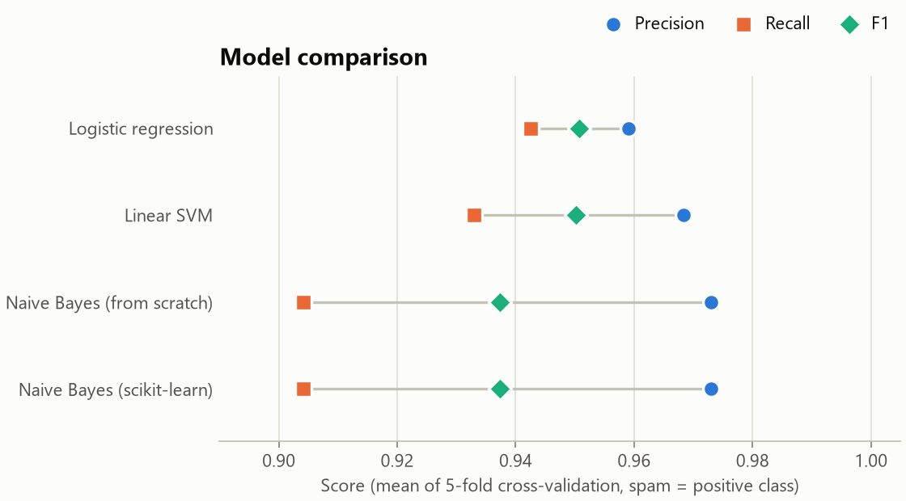
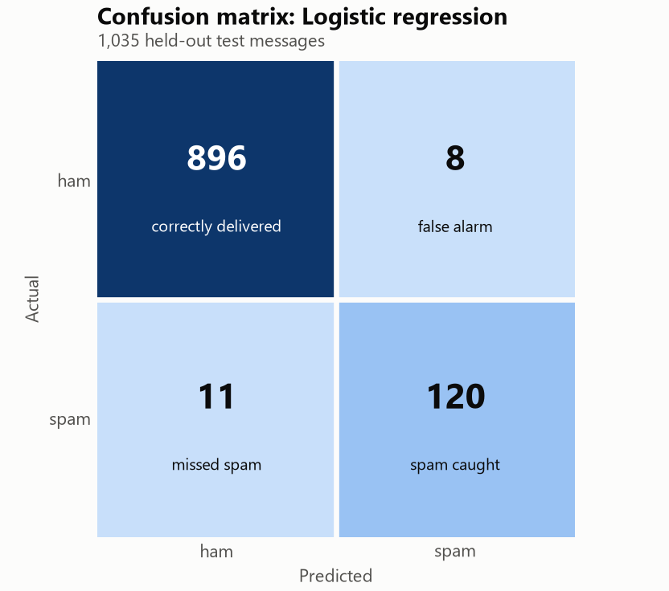
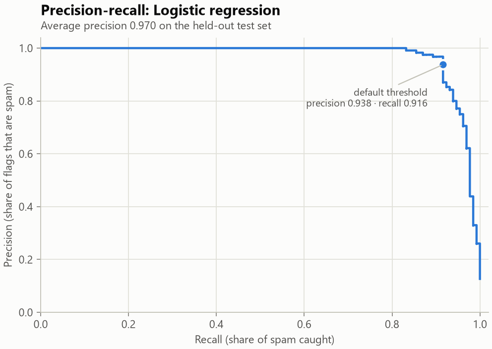

# sms-spam-classifier

Clasificador de spam en SMS construido de principio a fin en Python: un **Naive Bayes
multinomial implementado desde cero con NumPy**, comparado con tres modelos de
scikit-learn, con CLI, tests, tipado estricto y CI.



## Qué hay aquí

- **Un estimador propio compatible con scikit-learn.** `ScratchMultinomialNB`
  ([naive_bayes.py](src/spamclf/naive_bayes.py)) implementa `fit` / `predict` /
  `predict_proba` solo con NumPy, acepta matrices dispersas y pasa la batería oficial
  `check_estimator` de scikit-learn. Sus probabilidades coinciden con las de
  `MultinomialNB` hasta el último decimal.
- **Evaluación honesta.** Se eliminan los 403 mensajes duplicados antes de dividir los
  datos (si no, el mismo SMS puede acabar en entrenamiento y en test), la partición es
  estratificada y el vectorizador se reajusta dentro de cada *fold* de la validación
  cruzada.
- **Métricas pensadas para clases desbalanceadas.** Solo el 12,6 % de los mensajes es
  spam, así que responder siempre «ham» ya da un 87 % de *accuracy*. Se informa de
  precisión, recall, F1 y *average precision*.
- **Prácticas de ingeniería.** Paquete instalable con *src layout*, CLI con Typer,
  103 tests con pytest (98 % de cobertura), `ruff`, `mypy --strict` y GitHub Actions
  sobre Python 3.11–3.13 en Linux y Windows.

## Resultados

Dataset: [SMS Spam Collection](https://archive.ics.uci.edu/dataset/228/sms+spam+collection)
(UCI). 5.574 SMS en inglés → 5.171 tras quitar duplicados → 4.136 para entrenar y
1.035 para test (semilla 42).

**Validación cruzada de 5 *folds* sobre el conjunto de entrenamiento** (media ± desviación):

| Modelo                     | Precisión     | Recall        | F1            | Avg. precision |
| -------------------------- | ------------- | ------------- | ------------- | -------------- |
| Regresión logística        | 0,959 ± 0,017 | 0,942 ± 0,021 | 0,951 ± 0,018 | 0,978 ± 0,009  |
| SVM lineal                 | 0,968 ± 0,011 | 0,933 ± 0,021 | 0,950 ± 0,012 | 0,978 ± 0,009  |
| Naive Bayes (desde cero)   | 0,973 ± 0,019 | 0,904 ± 0,025 | 0,937 ± 0,022 | 0,956 ± 0,020  |
| Naive Bayes (scikit-learn) | 0,973 ± 0,019 | 0,904 ± 0,025 | 0,937 ± 0,022 | 0,956 ± 0,020  |

**Conjunto de test (1.035 mensajes que ningún modelo ha visto):**

| Modelo                     | Precisión | Recall | F1    | Avg. precision | Falsas alarmas | Spam no detectado |
| -------------------------- | --------- | ------ | ----- | -------------- | -------------- | ----------------- |
| SVM lineal                 | 0,960     | 0,916  | 0,938 | 0,971          | 5              | 11                |
| Naive Bayes (desde cero)   | 0,975     | 0,901  | 0,937 | 0,959          | 3              | 13                |
| Naive Bayes (scikit-learn) | 0,975     | 0,901  | 0,937 | 0,959          | 3              | 13                |
| Regresión logística        | 0,938     | 0,916  | 0,927 | 0,970          | 8              | 11                |

Lectura: los modelos lineales recuperan algo más de spam y ordenan mejor los mensajes
(*average precision* más alta); Naive Bayes es el más conservador, con menos falsas
alarmas. Las diferencias de F1 en test (0,927–0,938) caben dentro de la desviación
entre *folds* (±0,02), así que con estos datos no hay un ganador claro.

| Matriz de confusión | Curva precisión-recall |
| --- | --- |
|  |  |

El notebook [notebooks/01_analisis.ipynb](notebooks/01_analisis.ipynb) explora los
datos, estudia cómo mover el umbral de decisión (con umbral 0,77 la regresión logística
llega a 0,99 de precisión conservando 0,855 de recall) y revisa los mensajes en los que
el modelo se equivoca.

## Instalación

Requiere Python 3.11 o superior.

```bash
git clone <url-de-tu-repo>
cd sms-spam-classifier
python -m venv .venv
.venv\Scripts\activate          # Linux/macOS: source .venv/bin/activate
pip install -e ".[dev]"
```

## Uso

```bash
spamclf download                 # descarga el dataset (~200 KB) y verifica su SHA-256
spamclf compare                  # validación cruzada de los cuatro modelos
spamclf train --model logreg     # entrena, evalúa en test, guarda modelo y gráficas
spamclf predict "You have won a free prize, call now" "See you at lunch?"
```

Modelos disponibles: `nb-scratch`, `nb`, `logreg` y `svm`. Cada comando admite `--help`.

```text
                              Logistic regression
┌─────────────────────────────────────────────────────────┬─────────┬─────────┐
│ Message                                                 │ Verdict │ P(spam) │
├─────────────────────────────────────────────────────────┼─────────┼─────────┤
│ Congratulations! You have won a free prize, call        │ spam    │   99.9% │
│ 09061701461 now                                         │         │         │
│ Hey, are we still on for lunch tomorrow?                │ ham     │    2.0% │
└─────────────────────────────────────────────────────────┴─────────┴─────────┘
```

## Cómo funciona el Naive Bayes

Para un mensaje con recuentos de tokens `x` y una clase `c`:

```text
log P(c | x)  ∝  log P(c) + Σ_j x_j · log P(token_j | c)
```

`P(c)` es la fracción de mensajes de entrenamiento de la clase `c`, y
`P(token_j | c)` la fracción de tokens de esa clase que son el token `j`, con suavizado
aditivo `alpha` para que un token nunca visto en una clase no anule el producto.
Entrenar es, literalmente, contar: una multiplicación de la matriz *one-hot* de clases
por la matriz de recuentos.

## Estructura

```text
src/spamclf/
├── data.py          descarga verificada, carga y partición estratificada
├── naive_bayes.py   Naive Bayes multinomial desde cero (API de scikit-learn)
├── models.py        registro de pipelines (vectorizador + clasificador)
├── training.py      validación cruzada, entrenamiento y persistencia
├── evaluation.py    métricas de test y tokens más indicativos de spam
├── plots.py         figuras del informe
└── cli.py           comandos download / compare / train / predict
tests/               103 tests; usan un corpus sintético, sin red
notebooks/           análisis exploratorio y de errores
reports/             figuras y métricas generadas por la CLI
```

## Desarrollo

```bash
pytest --cov          # tests con cobertura
ruff check .          # linter
ruff format .         # formato
mypy src              # tipos (modo estricto)
pre-commit install    # opcional: ruff en cada commit
```

## Limitaciones

- El dataset es de SMS en inglés de alrededor de 2011 (Reino Unido y Singapur); el
  modelo no generaliza a otros idiomas ni al spam actual sin reentrenar.
- El conjunto de test tiene 131 mensajes de spam: un solo error mueve el recall 0,8
  puntos, así que diferencias pequeñas entre modelos no son concluyentes.
- Los modelos se guardan con joblib (pickle): carga solo ficheros que hayas entrenado tú.

## Datos

Almeida, T.A., Gómez Hidalgo, J.M., Yamakami, A. (2011). *Contributions to the Study of
SMS Spam Filtering: New Collection and Results.* DocEng'11. Distribuido por el UCI
Machine Learning Repository bajo licencia CC BY 4.0. El dataset no se incluye en el
repositorio: `spamclf download` lo obtiene de la fuente original.
